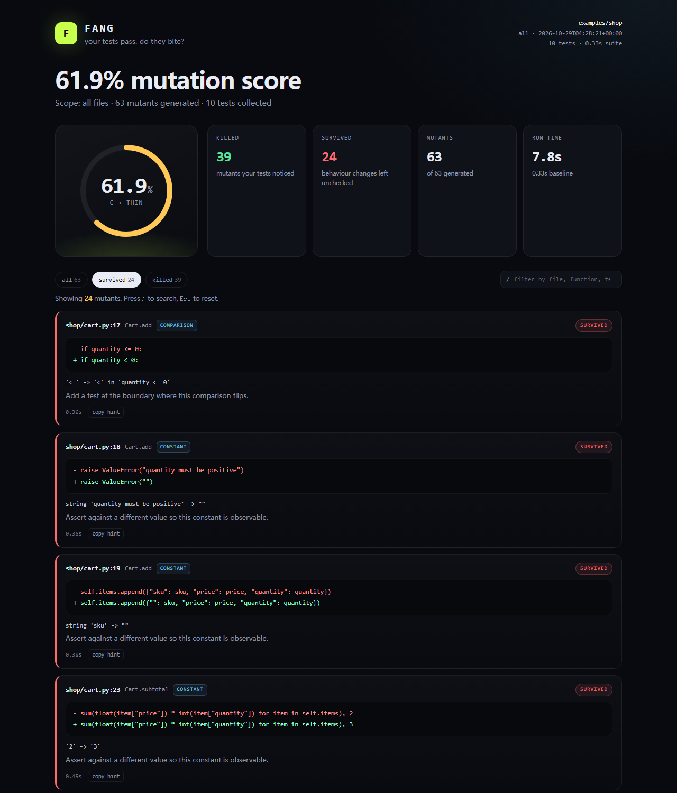

<h1 align="center">Fang</h1>

<p align="center"><strong>Your tests pass. Do they bite?</strong></p>

<p align="center">
  Diff-scoped mutation testing for Python, built for CI and coding agents.<br>
  Zero runtime dependencies. One command. No coverage runs.
</p>

<p align="center">
  
  
  
  
  
</p>

<p align="center">
  <a href="https://coisini-cyber.github.io/fang/"><strong>Live demo</strong></a> 路
  <a href="#quickstart">Quickstart</a> 路
  <a href="#the-pr-gate">PR gate</a> 路
  <a href="#coding-agents-mcp">MCP</a> 路
  <a href="#how-it-works">How it works</a> 路
  <a href="#accuracy-and-limits">Limits</a> 路
  <a href="#self-audit">Self-audit</a>
</p>

---

Coverage tells you which lines ran. **Fang tells you which lines your tests would notice.**

A test suite can execute every branch, assert almost nothing, and look great in a coverage report. Fang asks a blunter question: if the code were subtly wrong, would anything fail? It answers by generating small, valid mutations of the code in your diff, running the suite against each one, and reporting the mutations that survived.



```console
$ python -m fang run examples/shop --all

  FANG  路 mutation report
  examples/shop 路 all
  ������������������������������������������������������������������������������������������������������������������������������������������������������������������������������������������������������������������������������������
  SCORE    61.9%                ������������������������������������������������������������������  C 路 thin
           39 killed 路 24 survived
           10 tests 路 0.11s baseline 路 0.11s/mutant 路 63 mutants in scope
  ������������������������������������������������������������������������������������������������������������������������������������������������������������������������������������������������������������������������������������

  SURVIVORS (24) mutations your tests did not notice

  shop/inventory.py:19 路 Inventory.take  [comparison]
    - if count > available:
    + if count >= available:
    `>` -> `>=` in `count > available` 路 Add a test at the boundary where this
    comparison flips.

  shop/inventory.py:22 路 Inventory.take  [return]
    - return True
    + return None
    `return True` -> `return None` 路 Assert the return value; calling the function
    is not enough.
  ...
  verdict thin 路 unittest 路 10 tests
```

## Why this exists

Mutation testing is the honest measure of a suite, but the classic tools are built for nightly jobs: they mutate an entire repository and run the suite thousands of times. That is too slow for the loop most of us actually work in.

Fang takes the opposite position:

- **Only the diff.** It parses `git diff -U0`, maps added lines onto AST nodes, and mutates nothing else.
- **Fail fast.** Pytest runs with `-x`, unittest with `-f`. A mutant is usually killed by the first test that notices.
- **Sample when the diff is large.** Evaluate 120 mutants and report a 95% Wilson interval instead of pretending a sample is exact.
- **Cache aggressively.** A mutant is keyed by its edit, the source file, the test suite, and the config. Reruns are nearly free.
- **Isolate workers.** Each parallel worker gets a temporary copy of the project, mutates one file, restores it, and repeats.
- **Report like a product.** A dark HTML report with filters, a copyable hint per survivor, an SVG badge, a PR-comment markdown file, and machine-readable JSON.
- **Speak MCP.** Coding agents can call `fang_check_diff` after writing tests and get the survivors back as structured data.

No LLM. No API keys. No vector database. Just AST edits and test processes.

## Quickstart

Requires Python 3.9+ and git. Nothing else.

```bash
git clone <this-repo> fang
cd fang

# Run the included shop demo (10 tests, 63 mutants, ~4-7s on 4 workers)
python -m fang run examples/shop --all

# Or install the `fang` command
python -m pip install .
# pipx install .
```

The demo is deliberately under-tested. It scores **61.9%** and leaves 24 survivors, including an untested `express` shipping branch, an untested exactly-at-threshold case, and a `take()` return value nobody asserts.

Open the [live report](https://coisini-cyber.github.io/fang/report.html) or `docs/report.html` locally. The terminal output is a summary; the HTML has every mutant, filterable by status, file, function, or text.

## The PR gate

```bash
python -m fang run . --diff origin/main --sample 120 --min-score 80
```

- `--diff origin/main` mutates only lines **added** versus that revision. Untracked files count; deleted files cannot be mutated.
- `--sample 120` evaluates a deterministic sample of 120 mutants and prints the 95% Wilson interval.
- `--min-score 80` makes the process exit `1` when the score is below the threshold. Exit `2` means setup failed (no tests, red baseline, bad revision), not "tests found bugs".
- The HTML report and JSON are written even when the gate fails, so CI can upload them.

A green baseline is mandatory. If the suite is already red, Fang refuses to run: a failing mutant and a pre-existing failure would be indistinguishable. That is a feature.

Add it to GitHub Actions with the included composite action:

```yaml
- uses: actions/checkout@v4
  with:
    fetch-depth: 0

- uses: actions/setup-python@v5
  with:
    python-version: "3.12"

- uses: ./
  with:
    path: .
    diff: origin/${{ github.base_ref }}
    sample: "120"
    min-score: "80"
    report: fang-report.html

- uses: actions/upload-artifact@v4
  if: always()
  with:
    name: fang-report
    path: |
      fang-report.html
      fang-badge.svg
      fang-comment.md
```

For a monorepo, pass `--paths packages/api` and `--tests packages/api/tests`. For an agent-written PR, `--sample 60` is often enough to tell whether the new tests assert anything.

## Coding agents (MCP)

Fang ships a stdio MCP server with four tools:

| Tool | What it returns |
| --- | --- |
| `fang_check_diff` | Score, counts, and surviving mutants for the current diff, each with a hint |
| `fang_mutation_score` | The score only, for a diff or the whole project |
| `fang_list_survivors` | Paged survivors with file, line, operator, before/after, hint |
| `fang_doctor` | Detected runner, test command, file counts, config |

Typical agent loop:

1. Agent edits code and adds tests.
2. It calls `fang_check_diff` (`sample: 40`).
3. Fang returns survivors such as `count > available` ��?`count >= available`.
4. The agent adds the boundary test that the hint describes.
5. It calls again. The survivor disappears; the score rises.

Claude Desktop / generic MCP config:

```json
{
  "mcpServers": {
    "fang": {
      "command": "python",
      "args": ["-m", "fang", "mcp", "/absolute/path/to/project"]
    }
  }
}
```

OpenCode:

```json
{
  "mcp": {
    "fang": {
      "type": "local",
      "command": ["python", "-m", "fang", "mcp", "."]
    }
  }
}
```

Run `python -m fang mcp .` and speak newline-delimited JSON-RPC 2.0 over stdio. The server only writes protocol messages to stdout; logs never pollute the stream.

## How it works

```text
git diff -U0
    ��? added line numbers
    ��?AST parse ��������?candidate mutations ��������?compile() check
                                          ��?valid only
                                          ��?                              one file spliced per mutant
                                          ��?                     �����������������������������������������������������������������粹�������������������������������������������������������������?                     ��?                                        ��?             worker copy #1                            worker copy #N
        mutate ��?run suite (-x) ��?restore          mutate ��?run suite ��?restore
                     ��?                                        ��?                     ��������������������������������������������������������������������������������������������������������������������������������?                                          ��?                         killed / survived / timeout / crash
                                          ��?                       score, Wilson interval, HTML, JSON, MCP
```

Mutation operators are intentionally high-signal and small in number:

| Operator | Example | What a survivor usually means |
| --- | --- | --- |
| `comparison` | `a < b` ��?`a <= b` | A boundary is untested |
| `boolean` | `and` ��?`or` | Only one side of a condition is exercised |
| `arithmetic` | `a + b` ��?`a - b` | The numeric result is not asserted exactly |
| `constant` | `100` ��?`101` | A magic value is not observed |
| `return` | `return x` ��?`return None` | The return value is ignored |
| `conditional` | `if x:` ��?`if not x:` | One branch has no test |
| `statement` | `audit(x)` ��?`pass` | A side effect is unasserted |

**Score.** `detected / (detected + survived)`, where detected includes kills, timeouts, and mutant-induced crashes. When sampled, the report shows a 95% Wilson interval so the number is not over-claimed.

**Speed.** The shop demo generates 63 mutants and runs them in roughly 4-7 seconds on 4 workers. Fang's own mutation engine has 403 mutants; a 60-mutant sample runs in about 5 seconds with a 0.2s suite. The cost is fundamentally `mutants in scope �� suite time / workers`; `--diff`, `--sample`, and fail-fast are the levers.

**Cache.** `.fang/cache.json` stores killed/survived/timeout verdicts keyed by the mutant, source hash, test-suite fingerprint, and config. Editing a test invalidates the cache. Worker failures are never cached.

**Isolation.** Each worker copies the project (excluding `.git`, virtualenvs, caches, and build output), applies one mutation, runs the suite, and restores the file. The baseline runs in the real project. Tests must be hermetic and path-relative; use `--jobs 1` if they are not.

## Accuracy and limits

Fang is a sharp tool, not an oracle.

- **Survivors are questions, not bugs.** Some mutations are *equivalent*: the program cannot observe the difference. Changing a rounding precision from `2` to `3` on values that are already exact is the canonical example. Read the hint, then decide.
- **A kill can be weak.** A mutant that crashes on import is "detected", but it did not exercise a meaningful assertion. The report separates timeouts and crashes; use them as a signal to inspect.
- **Sampling is an estimate.** A 95% Wilson interval is not a guarantee that the unsampled mutants look the same. Increase `--sample` for release gates.
- **Python only, for now.** The target project must parse with the Python running Fang. Python 3.9+ is supported; code using newer syntax needs a newer interpreter.
- **The suite must be green and reasonably fast.** Fang runs the entire suite per mutant. A 10-minute suite makes full mutation testing impractical; narrow the scope or the test command.
- **Tests are not mutated by default.** They run the suite, but `tests/` is excluded from the candidate set. `--mutate-tests` exists if you want to audit the tests themselves.

## Self-audit

Fang was pointed at its own mutation engine:

```console
$ python -m fang run . --all --paths fang/mutators.py \
    --test-command "python -m unittest tests.test_mutators" \
    --sample 60 --jobs 4

  SCORE    73.3%                ������������������������������������������������������������������  B 路 decent
           44 killed 路 16 survived
           23 tests 路 0.20s baseline 路 sampled 60 of 403 路 95% CI 61.0%-82.9%
```

The first run scored 48.3%. The survivors were not noise: tests never asserted the return value of the internal `_add` helper, never exercised `visit_AnnAssign`, and never checked every entry in the operator tables. Adding those tests raised the sample to **73.3%**. The remaining survivors are real: return-value paths, a `dont_inherit` flag, and truncation widths that no test observes. The full report is in [`docs/self-audit.html`](docs/self-audit.html) and [live on GitHub Pages](https://coisini-cyber.github.io/fang/self-audit.html).

That is the intended workflow: run Fang, read the survivors, decide which ones matter, add tests, watch the score move.

## Where Fang fits

`mutmut`, `cosmic-ray`, and Stryker are mature, general-purpose mutation testers. If you want an exhaustive nightly mutation run with dozens of operators and deep framework integrations, use them.

Fang is for the inner loop and the PR gate: **only the diff**, a time budget, a defensible interval, and a result a human or an agent can act on in the next five minutes. It also happens to have no installation surface beyond Python itself.

## Commands

| Command | Purpose |
| --- | --- |
| `fang run [path]` | Mutate uncommitted changes, or the whole project when clean |
| `fang run --all` | Mutate every Python file in scope |
| `fang run --diff REF` | Mutate added lines versus a git revision |
| `fang run --staged` | Mutate staged changes versus HEAD |
| `fang run --lines 40-70` | Mutate a range, useful while developing a function |
| `fang run --sample N` | Deterministic sample with a 95% interval |
| `fang run --min-score N` | CI gate; exit 1 below the threshold |
| `fang run --report FILE` | HTML report (default `.fang/report.html`) |
| `fang run --markdown FILE` | PR-comment markdown |
| `fang run --badge FILE` | SVG score badge |
| `fang run --json` | Full machine-readable report on stdout |
| `fang init` | Write a starter `.fang.json` |
| `fang doctor` | Show the detected runner, test command, and counts |
| `fang mcp` | Start the MCP stdio server |
| `fang report` | Open the latest HTML report |

Config lives in `.fang.json` at the project root. CLI flags win over config; `fang init` writes a template.

## Project layout

```
fang/
  source.py       byte-offset-aware source splicing
  mutators.py     AST visitors ��?compile-checked mutants
  diffmap.py      git diff -U0 ��?added lines
  discovery.py    file walking, test-runner detection
  runner.py       subprocess execution, timeouts, killer parsing
  engine.py       scope, baseline, sampling, cache, parallel workers
  scoring.py      mutation score + Wilson interval
  term.py         ANSI terminal report
  report_html.py  self-contained HTML, badge, markdown
  mcp.py          stdio JSON-RPC MCP server
  cli.py          commands, gates, artifacts
examples/shop/    under-tested demo project
tests/            89 tests, stdlib unittest only
docs/             generated reports, badge, screenshot, architecture notes
```

## Development

```bash
python -m unittest discover -s tests -v   # 89 tests, under a minute
python -m compileall -q fang
```

The test suite includes a check that every import in `fang/` is standard library. That check is part of the product promise, not an afterthought.

See [`docs/architecture.md`](docs/architecture.md) for the data flow, caching rules, and failure modes, and [`AGENTS.md`](AGENTS.md) for the agent-facing workflow.

## License

MIT. See [LICENSE](LICENSE).

<p align="center"><sub>Named for the thing tests are supposed to have.</sub></p>
